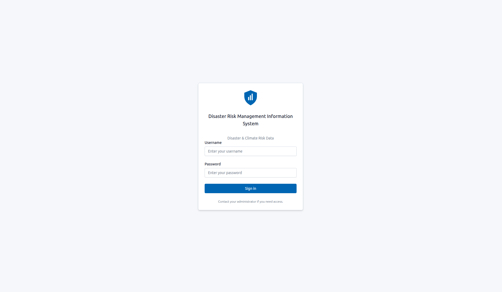
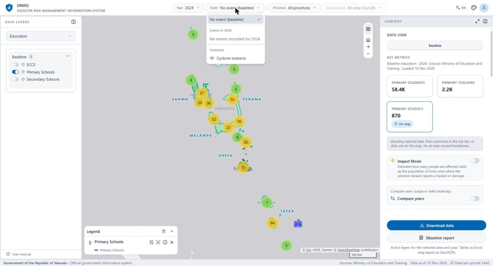
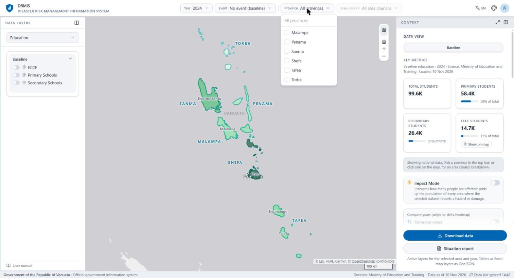
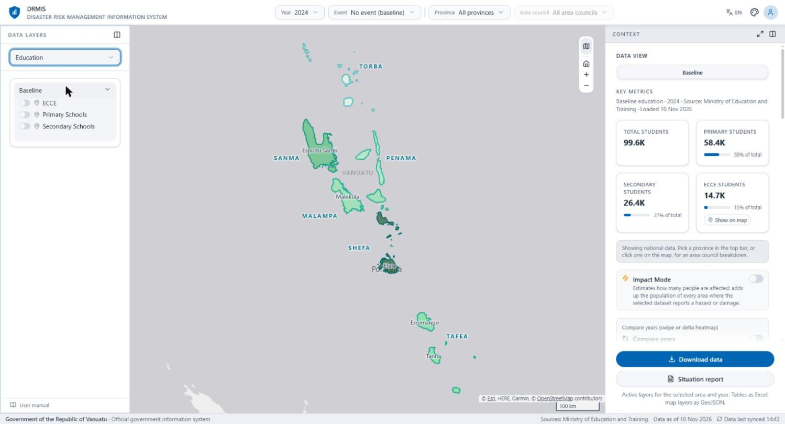
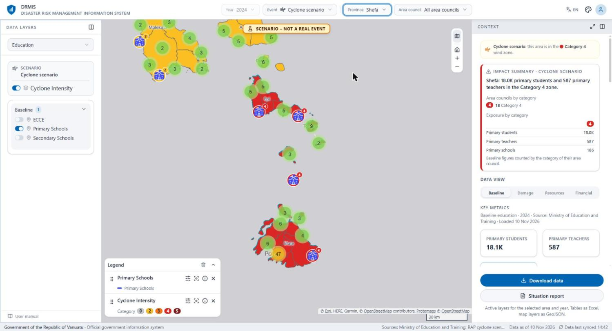
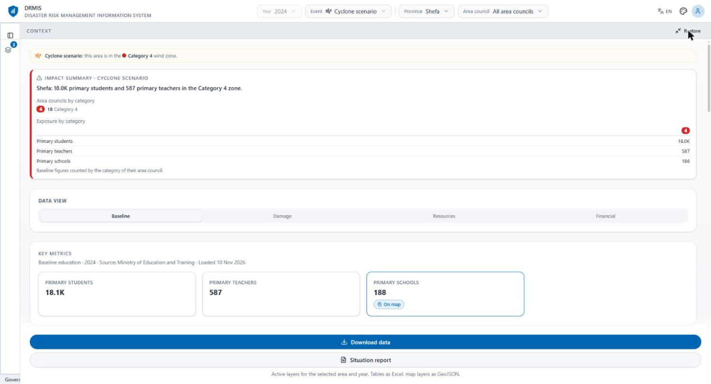
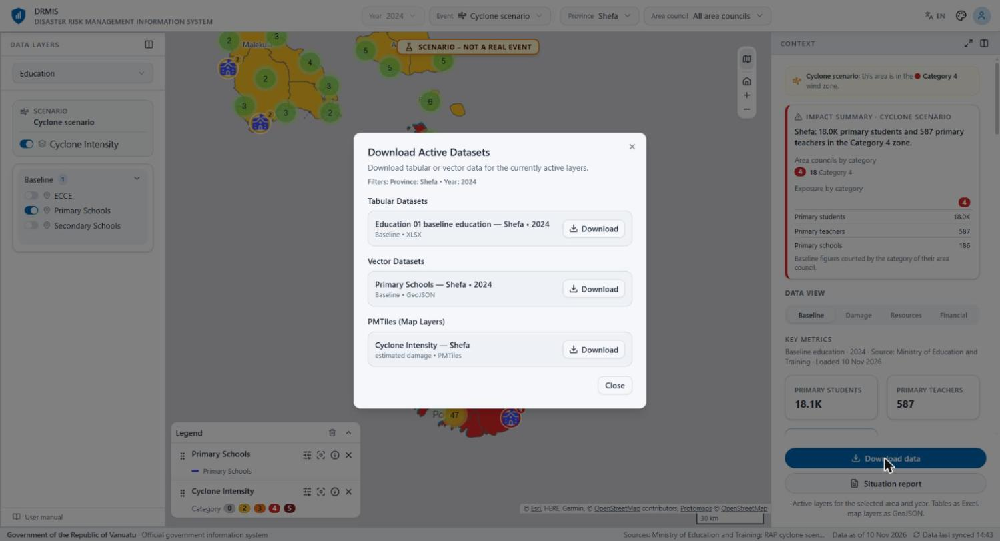
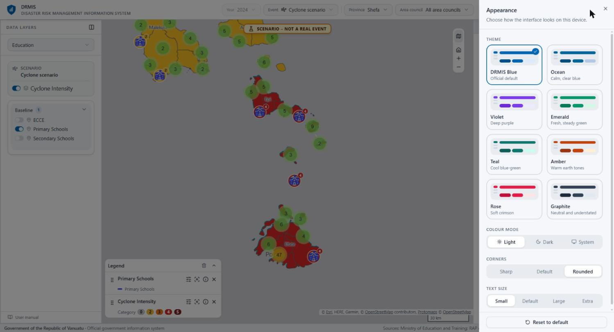
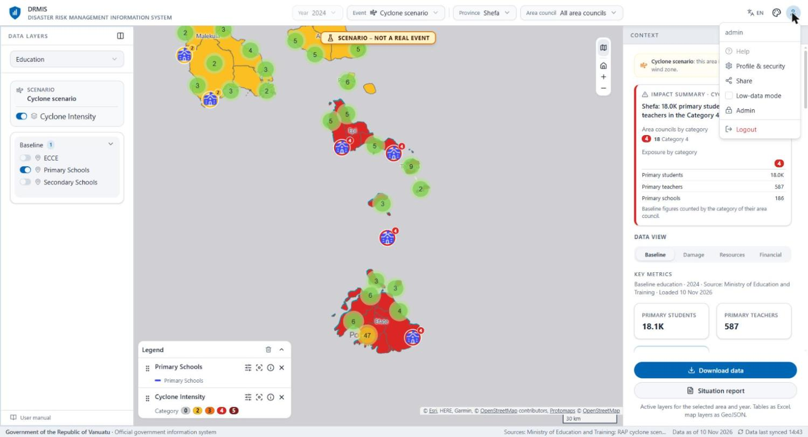

## Introduction

The **Disaster Risk Management Information System (DRMIS)** is the Government of Vanuatu's web application for exploring disaster and baseline data on a map. It brings together population, infrastructure, sector (cluster) and hazard data, shows it by province and area council, and lets you study past disaster events and modelled scenarios.

This manual explains, step by step, how to:

- sign in and sign out, and protect your session;
- find your way around the screen;
- choose a **year**, a **disaster event** or **scenario**, and an **area**;
- switch map layers on and off and read the legend;
- read charts, key figures (KPIs), the impact summary and cyclone information;
- compare years, play back a timeline and estimate affected population;
- download data and print a situation report;
- change the language, appearance and low-data settings;
- install DRMIS as an app and work with a poor connection.

::: {.callout-note}
## Who is this manual for?

It is written for everyday users (planners, officers and analysts). No technical knowledge is needed. Administrators who load data or manage accounts use a separate administration site (see [Section 17](#administrators)).
:::

### What you need

- A modern web browser (current Chrome, Edge, Firefox or Safari).
- A username and password from your administrator.
- An internet connection. DRMIS can show previously loaded data when offline (see [Section 14](#low-data-offline)).

### Words used in this manual

| Term | Meaning |
|------|---------|
| **Layer** | One dataset drawn on the map, for example "Schools" or "Cyclone wind zones". |
| **Cluster / Sector** | A group of related datasets, for example Education, Health or Infrastructure. |
| **Baseline** | Normal, non-disaster figures (for example the 2024 population). |
| **Event** | A real, recorded disaster such as a named cyclone, with dates. |
| **Scenario** | A *modelled* disaster used for planning and exercises. It is **not** a real event. |
| **Province / Area council** | Vanuatu's administrative levels. Area councils sit inside provinces. |
| **KPI** | A key figure shown on a card, such as a total or a percentage. |
| **Tabular data** | Numbers in tables (downloaded as Excel). |
| **Vector data** | Points, lines and areas on the map (downloaded as GeoJSON). |
| **Raster data** | Grid or image data such as land cover (downloaded as GeoTIFF). |

## 1. Signing In {#signing-in}

To use DRMIS you must sign in with credentials provided by your administrator.

1. Open the DRMIS address in your web browser (for example `https://drmis.info`).
2. The **Sign in** screen appears with the DRMIS logo and title.

{fig-align="center"}

3. Type your **Username**.
4. Type your **Password**.
5. Click **Sign in**.

If your details are correct you go straight to the dashboard. If you see an error message, check that Caps Lock is off and that you typed the username exactly, then try again.

::: {.callout-tip}
## Forgotten password or no access?

DRMIS has no self-service password reset. Contact your system administrator. Once signed in you can change your own password under **Profile & security** (see [Section 13](#profile-security)).
:::

::: {.callout-warning}
## Shared computers

Sign out when you finish (see [Section 16](#signing-out)) and never save your password in a browser on a computer other people use.
:::

## 2. The Dashboard at a Glance {#dashboard}

After signing in you see the main dashboard. Everything is on one screen:

| Area | Where | What it does |
|------|-------|--------------|
| **Header** | Top | Logo and name, the **Year / Event** picker, the **Province / Area council** picker, language, appearance and your account menu. |
| **Data layers** panel | Left | Choose a sector, then switch layers on or off. |
| **Map** | Centre | Shows the layers you switched on. Map buttons (zoom, basemap) are at the side. |
| **Context panel** | Right | Impact summary, cyclone banner, charts, key figures, filters, **Download data** and **Situation report**. |
| **Legend** | On the map | Explains the colours of the layers that are on. |
| **Status line / footer** | Bottom | "Data as of" date, sources and sync status. |

{fig-align="center"}

::: {.callout-note}
## One dashboard

Earlier versions had separate **Disaster** and **Climate** modes. These are now combined: land cover and other climate and baseline layers are available alongside disaster data in the same dashboard, so you no longer switch tabs.
:::

### Showing and hiding the side panels

- Each side panel can be collapsed to give the map more room. Use the small arrow or panel button on the panel edge. A button labelled **Data layers** brings the left panel back.
- The right panel hides itself when there is nothing to show for your current selection, and reappears when you switch on a layer.
- On a phone or narrow window the header wraps onto two lines so the pickers stay full size.

## 3. Choosing the Year and Event {#year-event}

The first picker in the header is **Year and disaster event**. It controls *when* the data refers to.

{fig-align="center"}

### Year

1. Click the **Year** dropdown.
2. Pick a year (for example **2024**).

The year selects which **baseline** figures are shown (population, facilities and so on).

### Event

1. Click the **Event** dropdown.
2. You see the group **Events in {year}**, listing the disasters recorded for that year, each with an icon for its hazard type (cyclone, volcano, flood, earthquake, tsunami, landslide, drought or wildfire), its name and its dates.
3. Choose an event, or choose **No event (baseline)** to look at normal conditions only.

What happens when you choose an event:

- The event's hazard footprint (for example the cyclone wind field) is drawn on the map.
- A banner at the top of the right panel names the event and its hazard type and dates.
- The **impact summary** and charts relate the baseline figures to the event (see [Section 8](#impact-summary)).
- The URL changes, so you can share exactly this view (see [Section 12](#sharing)).

If no events were recorded for the chosen year the list says **No events recorded for {year}**. If a footprint was never uploaded the panel says **No hazard footprint layer has been uploaded for this event.**

### Scenarios

Below the events there is a **Scenarios** group. A scenario is a modelled "what-if" disaster for planning and exercises.

- Scenarios are **not tied to a year**. The year you chose still decides which baseline figures are shown.
- Anything based on a scenario is marked **"Scenario – not a real event"**, with an explanation that it does not describe a real disaster. Never quote scenario results as real losses.

## 4. Choosing the Area {#area}

The second picker in the header is **Province and area council**. It controls *where* the data refers to.

1. Click **Province**. A list with checkboxes opens.
2. Tick one or more provinces. The button shows **All provinces** when none is chosen, or the name (or "3 provinces") when you choose some.
3. Click **Area council**. If no province is chosen it says **Choose a province first**. Otherwise tick one or more area councils (**All area councils** means no filter).

{fig-align="center"}

The selection is applied everywhere at once: map highlighting, charts, key figures, the impact summary, downloads and the situation report.

::: {.callout-tip}
## Tips

- Leave both pickers on *All* for a national picture of Vanuatu.
- You can also click an area on the map to see its details (see [Section 7](#map)).
- Province-level and area-council-level figures are never added together. Pick the level you need and read the numbers for that level.
:::

## 5. Data Layers (Left Panel) {#layers}

The left panel, **Data layers**, is where you decide what appears on the map.

{fig-align="center"}

### Choose a sector

1. Under **Sector**, open **Select sector…**.
2. Pick a cluster, for example Education, Health, Infrastructure, Population or Hazards.
3. The datasets in that sector are listed. They load only when you open the sector, so the panel stays fast.

### Switch a layer on or off

- Click a dataset's **name or switch** to put it on the map. Click again to remove it.
- You can switch on **many layers at once**, even from different sectors. Layers drawn later sit on top of earlier ones.
- If an event is selected, its own layers appear in a block labelled **Selected event**, so the event footprint is easy to find and toggle.
- A **Drivers** section lists layers that help explain risk (for example hazards and exposure) when the sector provides them.

### Layer types

| Type | Looks like | Download format |
|------|-----------|-----------------|
| Tabular | Area shading and charts by province or area council | Excel (XLSX) |
| Vector | Points, lines and polygons (for example schools, roads, zones) | GeoJSON |
| Raster | Continuous grid imagery such as land cover | GeoTIFF / VRT |

### Remove everything

In the legend, **Remove all layers** switches every layer off at once.

## 6. The Legend {#legend}

The **Legend** on the map explains the colours of the active layers.

- Each layer has its own entry. Click **Opacity and details** to open it.
- Use the **opacity slider** to make a layer more transparent so you can see what lies under it.
- Cyclone categories carry a **number inside each colour swatch** (Category 2 to Category 5; grey means no intensity), so they can be told apart without relying on colour.
- Land cover layers have their own class legend.

## 7. Using the Map {#map}

### Moving around

| Action | How |
|--------|-----|
| Pan | Click and drag |
| Zoom | Mouse wheel, double-click, pinch on touch screens, or the **+ / −** buttons |
| Return to the whole country | **Reset to national view** button |
| Change the background map | **Basemap** button (see below) |

### Basemaps

Click the **Basemap** button to choose the background map:

- **Light** and **Light (no labels)**
- **Dark** and **Dark (no labels)**
- **Bright**
- **Terrain**
- **Satellite**
- **Google Satellite**

The "no labels" versions are useful when the map has many of its own labels, and dark maps are easier to read at night or when projected.

### Information about a place

Click an area or a feature on the map. A popup shows its name and key values, and the right panel shows **drill-down insights** for that feature. Close it with the **X** on the panel, or press **Esc**.

### Place names

Place names are shown on the map; some layers also show labels such as the **cyclone name** on the track.

### When the map is empty

If no layer is on, the map shows a message inviting you to choose a sector and switch a layer on.

### Keyboard

| Key | Action |
|-----|--------|
| **Esc** | Close the open drawer (for example the time-series panel) or feature panel |
| **Tab** | Move between controls. A **Skip to map** link appears first for keyboard and screen-reader users |

## 8. The Context Panel (Right Panel) {#context-panel}

The right panel always reflects what is on the map and what you selected. It changes with what you do:

- a **table layer** shows charts and key figures;
- a **raster layer** (for example land cover) shows its legend and statistics;
- a **clicked feature** shows details about that feature;
- with **nothing relevant** the panel is hidden.

If your sector has no figures for the current selection, an amber note explains this and suggests choosing a province and area council to filter its map layers.

### Impact summary {#impact-summary}

When a cyclone event (or scenario) is selected, the **Impact summary** card at the top gives a plain-language headline and details:

- **Headline**: for example "Tafea: 12,300 people in the Category 4 zone." If nothing in the chosen area is in a wind zone it says so.
- **Area councils by category**: how many area councils lie in each cyclone category (Category 1 to 5) and how many are **Not affected**.
- **Exposure by category**: baseline figures (people, buildings, facilities) counted by the category of the area council they are in.

{fig-align="center"}

The summary scrolls together with the charts, and changes with the province and area council you picked. When you click an area council on the map, a sentence tells you which wind zone it is in.

::: {.callout-note}
## Exposure, not damage

The impact summary shows **who and what is exposed** to a hazard. It is not a measurement of actual damage. Use field assessments for damage.
:::

### Cyclone banner and intensity

For cyclone events the panel shows a banner with the **highest category** reached in your selection and an intensity card listing the area councils and their category, coloured as in the legend.

### Data view, dataset and attribute selectors

The **Data view** tabs (**Baseline**, **Damage**, **Resources**, **Financial**, depending on the sector) switch between kinds of figures for the sector. **Baseline** shows normal conditions; the others show damage, resources and financial data when available, which is most useful with an event selected.

When a tabular layer is active:

1. **Select dataset** chooses which table the charts use (for example population, or a damage assessment).
2. **Attribute filter** lets you focus on one measure, such as a type of facility, an age group or a damage class.

### Key figures (KPI cards)

Cards show totals and rates for your selection.

- Click a card to open a **drill-down** with a breakdown by area.
- Some cards are linked to a map layer. Use the small control on the card to **show or hide that layer** on the map.
- A small badge shows change compared with another year when comparing (see [Section 9](#compare)).

### Charts

Charts use the same filters as everything else. Typical views are:

- **Bar charts**: stacked by province, or grouped by area council.
- **Pie, radar and table views** for composition and ranking.
- **Time series**: a line chart over time with an **annual / monthly** toggle, shown in a drawer at the bottom (close it with Esc).
- **Land cover**: totals chart and a change matrix (flow diagram) showing which classes became which between two years.

Hover (or tap) a chart element for its exact value.

### Expand to full width {#expand}

For a bigger working space:

1. Click **Expand to full width** in the right panel header.
2. The panel opens over the map with more room for charts and KPIs.
3. Click **Restore panel width** to go back.

{fig-align="center"}

This is useful for analysis, for reading several charts together, and for presenting.

## 9. Comparing Years, Timeline and Impact Mode {#compare}

### Compare two years

Where the data has more than one year, switch on **Compare years** (below *Impact Mode* in the right panel; it offers a swipe or a delta heatmap) to look at two years.

1. Choose **Left (baseline)** year.
2. Choose **Right (compare)** year.
3. The map shows the two years (swipe or side-by-side) and the KPI cards show the **change** between them with an up or down badge.

### Timeline player

For layers with a long record (for example land cover from 2004 to the present year):

1. Press **Play** (the tooltip reads *Animate 2004 → current year*).
2. The map steps year by year. Choose a **Speed** with the speed control.
3. Press **Pause** to stop on a year.

### Impact Mode: estimated affected population {#impact-mode}

**Impact Mode** estimates how many people are affected. It adds up the population of every area where the selected dataset reports a hazard or damage.

1. Turn the **Impact Mode** switch on.
2. An **Estimated affected population** card appears with the total.

If the card shows "No estimate for this dataset", that dataset lacks either a population figure or a hazard/damage figure. Try a **Damage** dataset under *Data view*.

::: {.callout-warning}
## An estimate only

The figure is a first estimate from the loaded data. Verify it before operational use.
:::

## 10. Downloading Data {#download}

You can download the data behind the layers you have switched on.

1. **Switch on** at least one layer. (The button is disabled, and a tooltip says *Enable a data layer to download*, until you do.)
2. **Set the filters** you want: year, province and area council.
3. Click **Download data** at the bottom of the right panel.
4. The **Download Active Datasets** dialog opens.

{fig-align="center" width="500px"}

The dialog shows:

- the **active filters** (Province, Area council, Year);
- **Tabular datasets**, as **Excel (XLSX)**;
- **Vector datasets**, as **GeoJSON**;
- **PMTiles (Map layers)**, for event layers such as *Cyclone Intensity* for the chosen area;
- **Raster datasets**, as **GeoTIFF** or VRT links where available.

5. Click **Download** beside a dataset. A "Download started" message appears and the file goes to your browser's download folder.

::: {.callout-note}
## Filtered downloads

Downloads respect your current filters. With *Shefa* and *2024* chosen, you receive only Shefa for 2024. For the whole country, set the pickers to *All* first.
:::

If a download fails, a "Download failed" message appears. Retry; if it persists (for example a GeoTIFF export), tell your administrator.

## 11. Situation Report {#situation-report}

The **Situation report** button (below *Download data*) produces a one-page printable report of your current view.

1. Select the year, event and area you want to report on, and switch on the relevant layers.
2. Click **Situation report**. The print dialog opens.
3. Choose **Save as PDF** as the printer to create a file you can email, or print directly.

The report contains:

| Section | Content |
|---------|---------|
| **Area** | The province(s)/area council(s) chosen |
| **Baseline year** | The year selected |
| **Event** | The chosen event, or "No event selected (baseline data)" |
| **Generated** | Date and time, and who generated it |
| **Key figures** | The headline numbers for your selection |
| **Map layers shown** | The layers you had switched on |
| **Sources** | The data sources |

The report ends with a disclaimer: figures are estimates from the data loaded at the time of printing and should be verified before operational use.

## 12. Sharing a View {#sharing}

Your selections (year, event, area, layers) are stored in the page address, so you can send someone exactly what you see.

1. Click your **account icon** in the top right, then **Share**.
2. Click **Copy Link**. A "Link copied to clipboard" message appears.
3. Paste the link in an email or message. The recipient needs a DRMIS account to open it.

## 13. Account Menu, Language and Appearance {#profile-security}

### Language

Click the language button (shows **EN**, **FR** or **BI**) in the header and choose:

- **English**
- **Français**
- **Bislama**

The header, pickers, impact and event summaries and the situation report change language. Dataset names and some technical labels stay in English. The Bislama text is a first draft that is being reviewed.

### Appearance

Click the **Appearance** button in the header to open the appearance panel:

| Setting | Choices |
|---------|---------|
| **Theme** | DRMIS Blue (official default), Ocean, Violet, Emerald, Teal, Amber, Rose, Graphite |
| **Colour mode** | Light, Dark, System (follows your device) |
| **Corners** | Sharp, Default, Rounded |
| **Text size** | Small, Default, Large, Extra |

{fig-align="center" width="400px"}

Use **Large** or **Extra** text size for easier reading or for projectors. Your choices are saved to your account and follow you to other devices. A **Reset** button returns everything to the defaults.

### Account menu

{fig-align="center"}

Click the round **account icon** at the top right. The menu shows your username and these items:

| Item | What it does |
|------|--------------|
| **Help** | Reserved for help; use this manual meanwhile |
| **Profile & security** | Change your password and set an optional screen lock (below) |
| **Share** | Copy a link to the current view |
| **Low-data mode** | Tick to load fewer, lighter map tiles (see [Section 14](#low-data-offline)) |
| **Lock screen** | Appears when you have set a PIN; locks the screen immediately |
| **Admin** | Appears only for administrators; opens the administration site |
| **Logout** | Signs you out |

### Screen lock (PIN)

To protect an unattended computer:

1. Open **Profile & security**.
2. Set **Auto-lock after inactivity** to Off, 1, 5, 10, 15 or 30 minutes.
3. Enter a **4-digit PIN** and confirm it.

After the chosen idle time, or when you choose **Lock screen**, a lock screen hides the dashboard. Enter your PIN to continue. After **5 wrong attempts** you are signed out and must sign in again.

## 14. Low-Data Mode, Offline Use and Installing the App {#low-data-offline}

### Low-data mode

On a slow or metered connection (for example mobile data in an outer island), tick **Low-data mode** in the account menu. DRMIS then loads fewer and lighter map tiles. If DRMIS detects a slow connection it switches this on automatically and tells you so; you can untick it.

### Offline and sync indicators

- **Data last synced …** shows when data was last refreshed.
- **Offline – showing saved data** means you have lost connection; DRMIS shows what it already stored. Features that need the server (downloads, new layers) wait until you are back online.
- **Data not synced yet** appears before the first successful load.

### Install DRMIS as an app

DRMIS can be installed like an app on a phone, tablet or computer for quicker access and offline use.

1. When the **Install app** pill appears at the bottom centre of the screen, tap it and confirm.
2. Or use your browser's menu: *Install app* / *Add to Home Screen*.

When a new version is available, a pill says **A new version of DRMIS is ready**. Click **Reload page** to update, or **Not now** to wait.

## 15. Quick Reference {#quick-reference}

| Action | What to do |
|--------|------------|
| Sign in | Enter username and password, click **Sign in** |
| Choose the year | Header → **Year** |
| Look at a disaster event | Header → **Event** → pick an event |
| Look at a planning scenario | Header → **Event** → **Scenarios** |
| Show normal conditions | Event → **No event (baseline)** |
| Choose an area | Header → **Province**, then **Area council** |
| Add data to the map | Left panel → **Sector** → switch a layer on |
| Remove all layers | Legend → **Remove all layers** |
| Change layer transparency | Legend → **Opacity and details** |
| Change background map | **Basemap** button on the map |
| Back to all of Vanuatu | **Reset to national view** |
| See details of a place | Click it on the map |
| Close a feature panel or drawer | **Esc** |
| Bigger charts | Right panel → **Expand to full width** |
| Estimate affected people | **Impact Mode** switch |
| Save data | **Download data** → **Download** |
| Make a PDF report | **Situation report** → **Save as PDF** |
| Send my view to someone | Account icon → **Share** → **Copy Link** |
| Change language | Header language button (EN / FR / BI) |
| Larger text or dark mode | Header **Appearance** button |
| Use less data | Account icon → **Low-data mode** |
| Lock the screen | Account icon → **Lock screen** (needs a PIN) |
| Sign out | Account icon → **Logout** |

## 16. Signing Out {#signing-out}

1. Click the round **account icon** at the top right.
2. Choose **Logout**.

You return to the Sign in screen. Always sign out on shared computers.

## 17. For Administrators {#administrators}

Administrators see an **Admin** item in the account menu. It opens the administration site (`/admin/`), where they can:

- create and manage user accounts;
- manage clusters, datasets and their metadata;
- import tabular data from CSV files (several files at once; the dataset is suggested from the file name, with a progress bar during upload);
- upload map layers (vector and raster) and disaster events with their footprint layers, including cyclone intensity GeoJSON.

Installation and server notes are in `DEPLOYMENT_VM.md` and `DEPLOYMENT_MANUAL.md`; the cyclone upload format is in `CYCLONE_INTENSITY_GEOJSON_UPLOAD.md` (all in the `docs` folder of the project).

## 18. Troubleshooting {#troubleshooting}

| Problem | What to try |
|---------|-------------|
| I cannot sign in | Check username and password; contact your administrator |
| The map is blank | Switch on a layer; click **Reset to national view**; try another **Basemap** |
| Layers are missing in a sector | Open the sector and wait for the list to load; check you are online |
| A chart or KPI shows nothing | Clear the province/area council filter; check the year; the sector may have no figures for that selection |
| The Event list is empty | No events are recorded for that year; try another year |
| **Download data** is greyed out | Switch on at least one layer |
| A download failed | Retry; reload the page; tell your administrator if it repeats |
| The page is slow | Tick **Low-data mode**; switch off layers you do not need |
| Old data appears | Click **Reload page** if offered, or refresh the browser |
| Labels are too small | **Appearance** → **Text size** → Large or Extra |
| I locked myself out | After 5 wrong PINs you are signed out; sign in again with your password |

## 19. Good Practice

- State the **year and event** whenever you quote a figure.
- Never present a **scenario** as a real event.
- Treat impact figures as **estimates** and confirm them with field reports.
- Keep downloaded files secure; they may contain sensitive information.
- Report data errors to your administrator, naming the layer, area and year.
